Проект: JobFinder

# Краткое описание проекта
Необходимо создать приложение для поиска работы. В приложении должна быть обеспечена возможность как поиска работы со стороны соискателя, так и поиск соискателя со стороны работодателя. Требуется добавить уникальную "фишку" сервиса --- использование систем искусственного интеллекта для поиска соискателя по описанию.

# Анализ предметной области
Существуют соискатели и работодатели. У соискателей есть резюме. Работодатели размещают вакансии, на которые соискатели могут оставлять отклики с прикреплением резюме. В резюме должно указываться владение языками, технические навыки, категория (IT, закупки, маркетинг и т.д.), опыт работы и образование.

# Анализ аналогичных решений
Сначала необходимо сформулировать критерии сравнения.

1. Доступность в РФ. Является одним из самых важных критериев, потому что предлагаемый сервис ориентирован на пользователей из России. Платформа должна предоставлять доступ для пользователей без применения сторонних инструментов.

2. Открытое API. Наличие открытого доступа к API помогает работодателю использовать сервис в своей внутренней системе.
3. Средства автоматизированного поиска соискателей. Наличие подобных средств снижает нагрузку работодателя при поиске сотрудников.

| Платформа     | Доступность в РФ | Открытое API | Средства автоматизированного поиска соискателей |
|---------------|---------------|-----|--------------------|
| hh.ru         | Да            | Да  | За отдельную плату  |
| LinkedIn      | Ограничена    | Нет | За отдельную плату  |
| Glassdoor     | Ограничена    | Нет | Нет                 |
| Habr Карьера  | Да            | Нет | Нет                 |

# Целесообразность и актуальность
JobFinder актуален, так как предлагает бесплатную доступную в РФ платформу с применением автоматизированных средств поиска соискателей с применением новых технологий на основе систем искусственного интеллекта.

# Акторы

1. Гость. Незарегистрированный пользователь, который может просматривать выложенные вакансии, либо зарегистрироваться/авторизоваться.

2. Соискатель. Может составлять и изменять резюме, откликаться на вакансии, просматривать статусы своих откликов и выполнять те же действия что и гость.

3. Работодатель. Может выкладывать вакансии, изменять состояния полученных откликов и выполнять те же действия, что и гость.

# Требования

Функциональные требования:

- регистрация, вход, выход и редактирование своего профиля,
- поиск и просмотр вакансий с фильтрами, в том числе для гостя,
- создание, редактирование и удаление собственных резюме,
- публикация и управление собственными вакансиями работодателя,
- отправка отклика со своим резюме,
- просмотр своих откликов,
- поиск резюме по фильтрам и семантический подбор кандидатов к вакансии,
- ограничение действий по роли и владельцу данных.

Нефункциональные требования:

- p95 поиска и просмотра вакансий ≤ 500 мс, доля 5xx < 1% при 20 одновременных пользователях в течение 5 минут после прогрева 60 с,
- после штатного перезапуска backend и БД сохранены 100 из 100 подтверждённых записей вакансий и откликов; чтение восстанавливается не позднее 60 с после готовности БД,
- 100% проверок записи без действующей авторизации и изменения чужого резюме, вакансии или отклика завершаются 401/403 без изменения данных.

# Use-case диаграмма
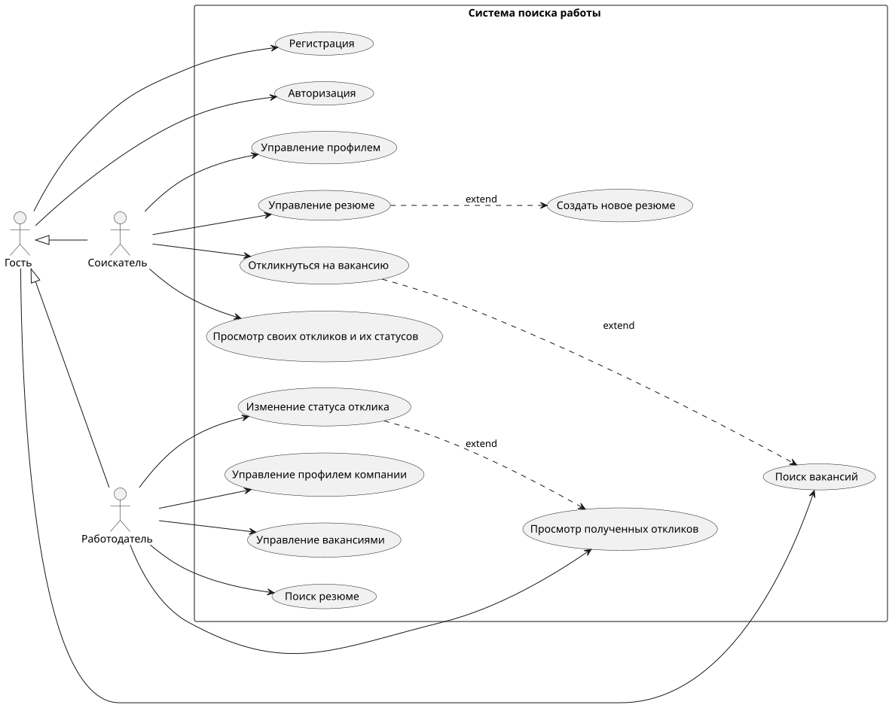

# ER-диаграмма сущностей
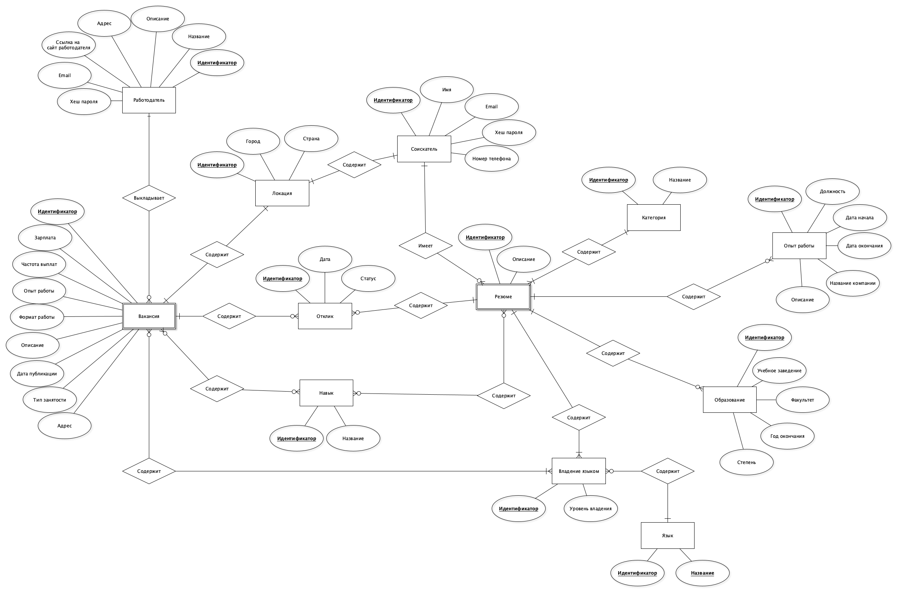

# Пользовательские сценарии

## Публикация вакансии и отработка отклика
Алгоритм:

1. Авторизация;
2. Нажатие кнопки создать вакансию;
3. Заполнение данных вакансии: зарплаты, типа занятости, формата работы, описания, требуемых навыков;
4. Нажатие кнопки публикации;
5. Получение отклика от соискателя;
6. Анализ кандидата;
7. Изменение статуса отклика.

## Поиск работы с использованием фильтров
Алгоритм:

1. Авторизация;
2. Настройка фильтров вакансии поиска
3. Нажатие кнопки поиск;
4. Изучение вакансий;
5. Нажатие кнопки отклика на интересующей вакансии;
6. Выбор резюме для отклика;
7. Нажатие кнопки подтвердить.

## Поиск работы гостем
Алгоритм:

1. Настройка фильтров вакансии поиска
2. Нажатие кнопки поиск;
3. Изучение вакансий;
4. Нажатие кнопки отклика на интересующей вакансии;
5. Регистрация;
6. Создание резюме;
7. Выбор резюме для отклика;
8. Нажатие кнопки подтвердить.

# Формализация ключевых бизнес-процессов
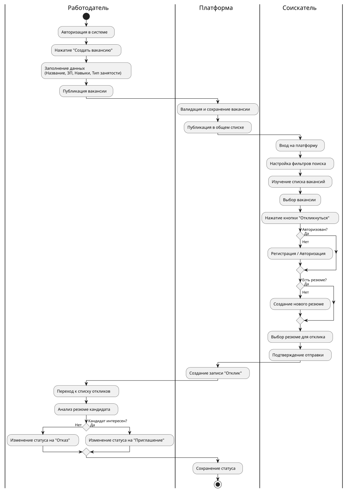

Детализация в BPMN с ветвлениями и обработкой ошибок:

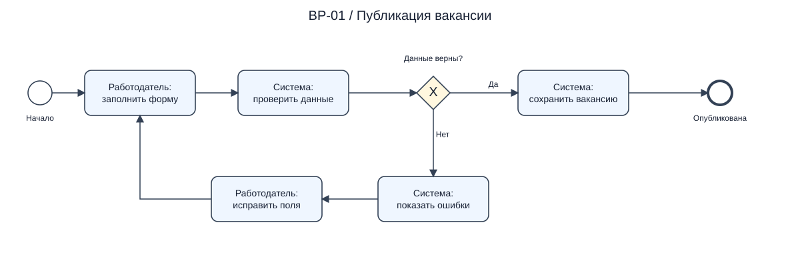
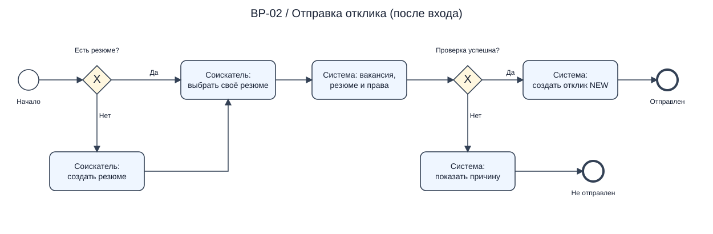
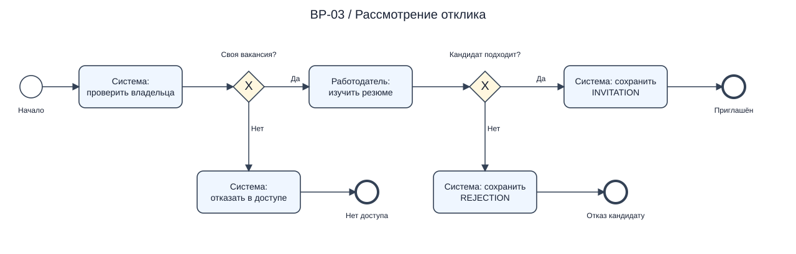

# Тип приложения
Web SPA
Backend: Java (SpringBoot)
Frontend: TypeScript (React)

БД: PostgreSQL 15; Redis хранит токены, Qdrant хранит векторы резюме; Ollama вычисляет эмбеддинги.

# C4
## Context диаграмма
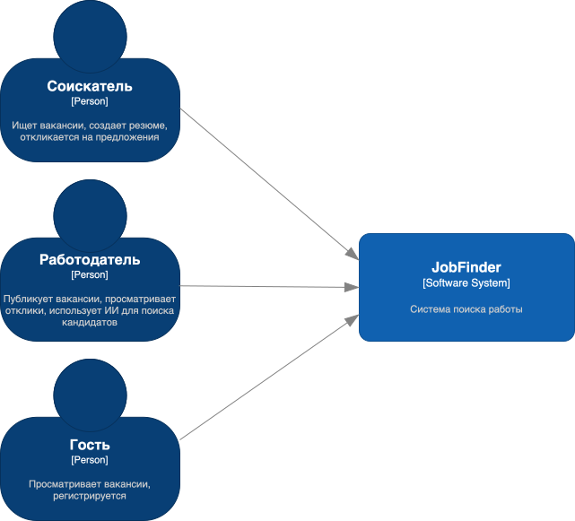
## Container диаграмма
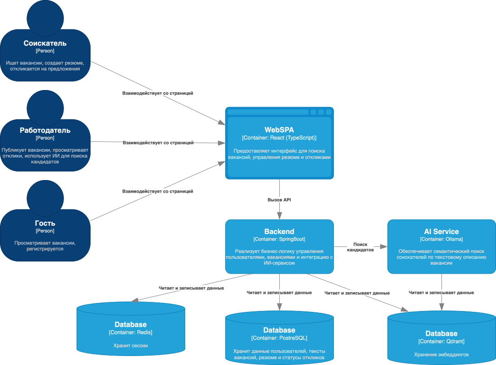
## Component диаграмма

## Code диаграммы
### UML диаграмма классов для модуля вакансий
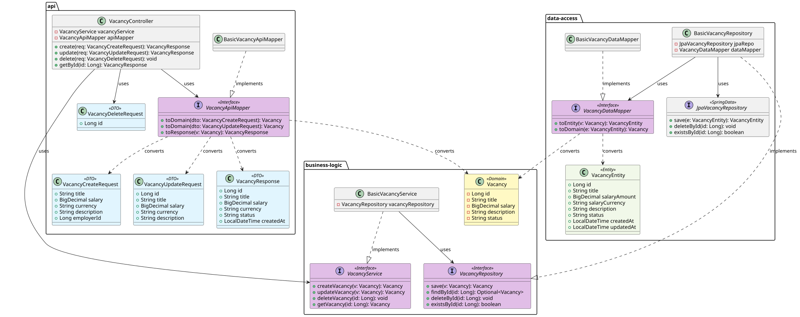
### UML диаграмма классов для модуля работодателей

### UML диаграмма классов для модуля резюме
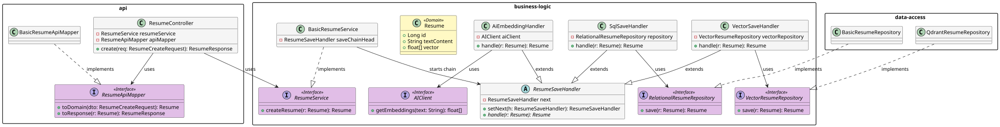
### UML диаграмма классов для модуля умного поиска
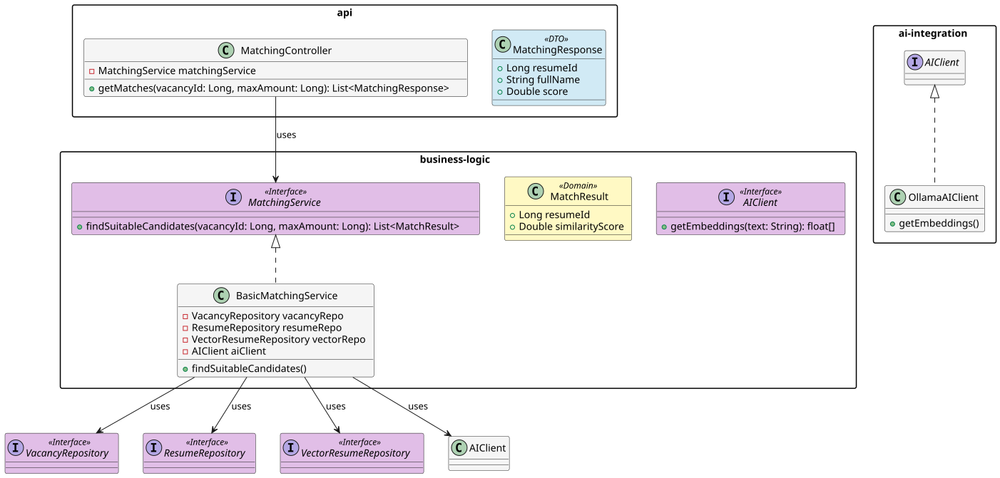
### UML диаграмма классов для модуля авторизации
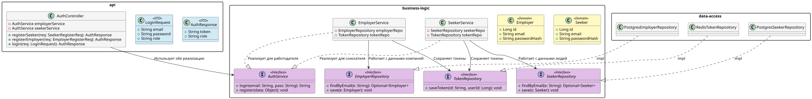
### L4 диаграмма всех классов

# Sequence диаграммы
## Sequence диаграмма сохранения резюме
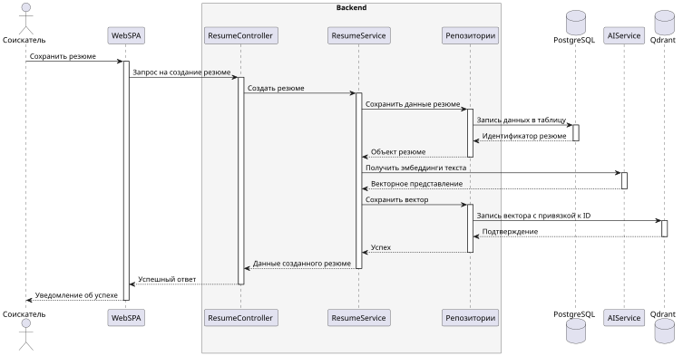

## Sequence диаграмма использования системы автоматизированного поиска
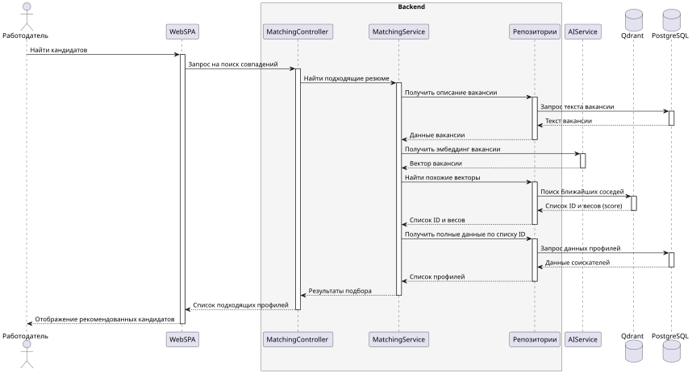

# DBML схема
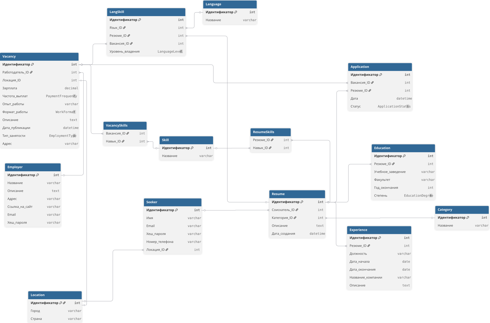

# Архитектурные решения

## ADR-001. Выбор реляционной модели хранения данных

База данных сервиса поиска работы должна хранить сведения о соискателях, работодателях, резюме, вакансиях, откликах и справочниках. Для выбора модели хранения определены три критерия:

- **К1** — поддержка неиерархических связей между сущностями;
- **К2** — обеспечение целостности данных для предотвращения противоречивой информации об одной и той же сущности;
- **К3** — поддержка связей типа «многие ко многим».

Были рассмотрены иерархическая модель, сетевая модель, модель на основе инвертированных списков, реляционная и постреляционная модели.
По результатам сравнения реляционная модель соответствует всем трём критериям.

## ADR-002. Выбор модульного монолита

Серверную часть сервиса поиска работы необходимо разделить на функциональные области: учётные записи, резюме, вакансии, отклики и подбор кандидатов. При этом приложение должно оставаться простым в разработке и развёртывании.

Были рассмотрены монолит без явного разделения на модули, модульный монолит и микросервисная архитектура. В первом случае сложнее контролировать зависимости между функциональными областями. Микросервисы позволяют независимо развёртывать и масштабировать сервисы, но требуют организации сетевого взаимодействия и обработки частичных отказов.

Выбран модульный монолит: бизнес-логика разделяется на модули, взаимодействующие через определённые интерфейсы внутри одного приложения. Это позволяет разграничить ответственность модулей и сохранить единое развёртывание. Ограничение такого решения — необходимость развёртывать и масштабировать приложение целиком.

[Эскизы основных экранов](img/screen-sketches.svg): поиск вакансий, резюме соискателя и рассмотрение откликов.
